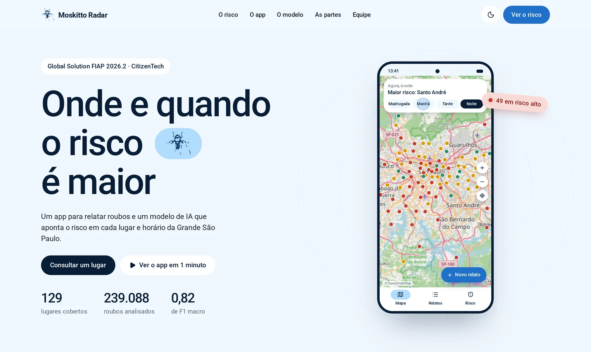
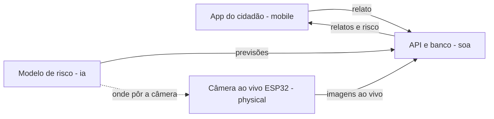

<h1 align="center">
  <picture>
    <source media="(prefers-color-scheme: dark)" srcset="site/public/marca/logo-mark-white.svg">
    
  </picture>&nbsp;Moskitto Radar
</h1>

Onde e quando o risco de roubo é maior na <strong>Grande São Paulo</strong>: um app para relatar roubos e um modelo de IA que aponta o risco de cada lugar e horário.

  &nbsp;
  &nbsp;
  &nbsp;
  &nbsp;
  

<a href="https://gs2026.cotoo.dev"><strong>gs2026.cotoo.dev</strong></a>

Global Solution FIAP 2026.2 · CitizenTech · Engenharia de Software, 3º ano · Entrega em 19/11/2026

 

  <a href="https://gs2026.cotoo.dev">
    <picture>
      <source media="(prefers-color-scheme: dark)" srcset="docs/imagens/site-escuro.webp">
      
    </picture>
  </a>

---

### Sobre

O morador relata um roubo pelo app: o local aproximado, o horário e o tipo, sem nenhum dado pessoal. Um modelo de
machine learning, treinado com os roubos públicos da SSP-SP, aponta onde e em que horário o risco é maior, e o app
mostra isso num mapa e numa tela de previsão.

A cobertura é a Região Metropolitana de São Paulo, com **129 lugares**: os 3 bairros da Av. Paulista, onde o projeto
começou, 88 distritos da capital e 38 municípios vizinhos.

### Como funciona

A API roda num Windows Server com IIS (`os/`). O app de moderação em C# (`csharp/`) tem duas versões: a de
Windows Forms, entregue na matéria, com relatos em memória, e uma para Linux, em Avalonia, que modera os relatos
direto na API. A segurança da solução está em `cyber/`, e a arquitetura e o pitch, em `testing/`.

### As partes

Cada matéria da GS constrói uma parte da mesma solução. Cada pasta tem o seu README com o que foi feito, como rodar e
onde estão as evidências.

| Pasta | Matéria | O que tem |
| --- | --- | --- |
| [`mobile/`](mobile/) | Mobile Development & IoT | App do cidadão (React Native + Expo): mapa, relatos, previsão e vídeo demo |
| [`ia/`](ia/) | IA & Machine Learning | Modelo que prevê o risco por lugar e horário, com os dados da SSP-SP |
| [`soa/`](soa/) | Arquitetura Orientada a Serviços | API REST e banco de dados dos relatos |
| [`csharp/`](csharp/) | C# Software Development | App de moderação dos relatos, em Windows Forms e numa versão para Linux |
| [`physical/`](physical/) | Physical Computing | Câmera ao vivo com ESP32 (Wokwi) no ponto de ônibus do lugar de maior risco do modelo |
| [`os/`](os/) | Operating Systems | Windows Server, AD, DNS e IIS hospedando a API |
| [`cyber/`](cyber/) | Cybersecurity | Gestão de riscos e controles de segurança |
| [`testing/`](testing/) | Testing, Compliance & QA | Arquitetura (ArchiMate) e pitch |
| [`site/`](site/) | Toda a solução | Página que apresenta e demonstra as partes juntas |

### Site

O [**site**](https://gs2026.cotoo.dev) apresenta a solução inteira numa página só:

- **Simulação do app:** um celular na capa que dá para tocar, com o mapa de risco, os relatos e o envio de um relato.
- **Risco ao vivo:** o mapa dos 129 lugares com a previsão do modelo, por lugar e faixa do dia.
- **O app e o modelo:** loops gravados do app e os números do modelo, como o pico de roubos e o F1.
- **Do relato ao mapa:** as seis etapas do caminho de um relato, cada uma com um exemplo que dá para mexer.
- **As oito partes e a equipe:** o que cada matéria entrega e quem faz.

O código está em [`site/`](site/).

---

### Dados e privacidade

- Os relatos do app são **simulados**. O modelo usa as contagens agregadas de roubos da SSP-SP, que são públicas.
- **Nenhum dado pessoal real**: sem nome, documento ou placa, e o local é sempre aproximado.

> [!IMPORTANT]
> O app **não substitui** o boletim de ocorrência.

**ODS:** 11 (Cidades e comunidades sustentáveis) como principal, 9 e 10 como secundários.

### Equipe

| Nome | RM | Partes |
| --- | --- | --- |
| Gabriel Couto | RM559579 | `ia/` · `mobile/` |
| Gabriel Kato | RM560000 | `os/` · `physical/` |
| João Vitor de Matos | RM559246 | `soa/` · `csharp/` |
| Marcelo Affonso | RM559790 | `cyber/` · `testing/` |

### Documentação

| Guia | O que cobre |
| --- | --- |
| [Especificação](docs/especificacao.md) | Requisitos, modelo de dados, arquitetura e fluxo |
| [Contexto da GS](docs/README.md) | Briefing, regras e rubricas de cada matéria |
| [Checklist de entregas](docs/checklist.md) | O que falta em cada parte |
| [Ficha da CitizenTech](docs/ficha-citizentech.md) | A ficha do projeto |
| [`AGENTS.md`](AGENTS.md) | Formato comum dos dados, rotas da API e quem faz o quê |

---

  Feito para a Global Solution FIAP 2026.2, com dados públicos e relatos simulados.

