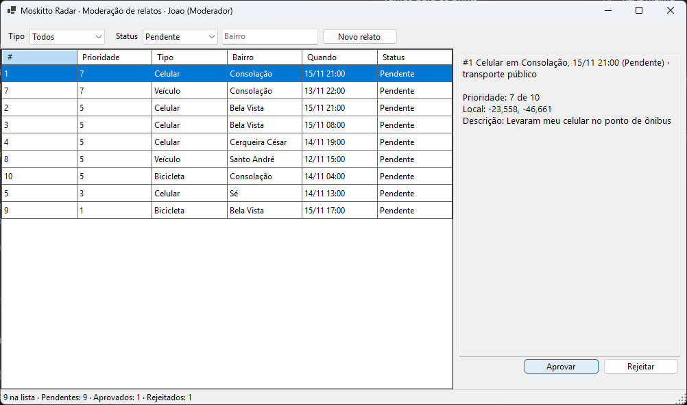
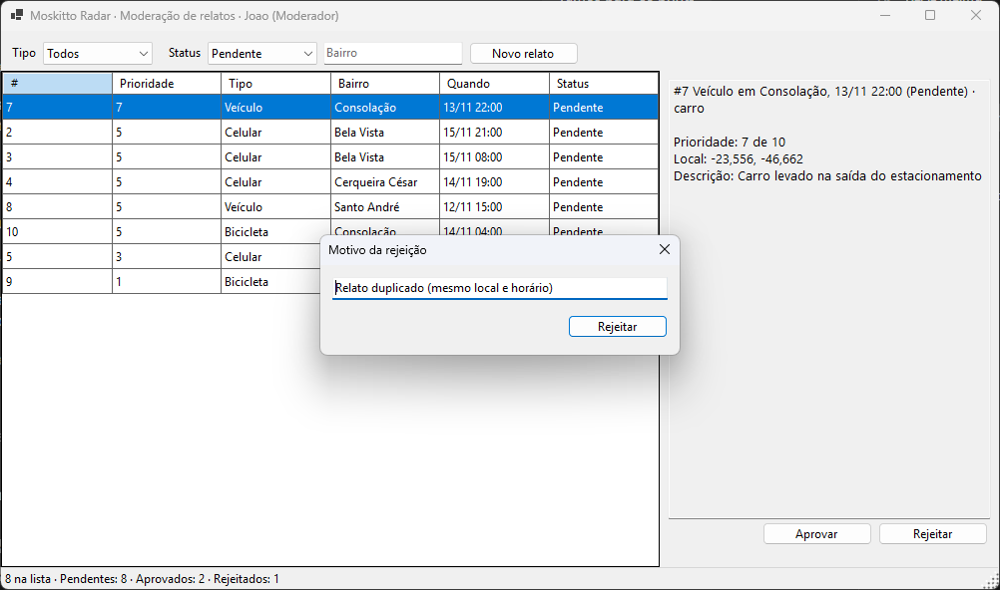
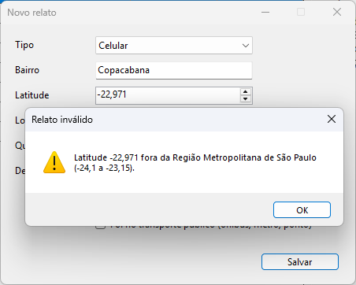

# Evidências · C#

Prints do app funcionando (Windows 11, .NET 10). Os relatos são simulados.

| # | Mostra |
|---|---|
| [01](01-entrada.png) | Entrada: apelido e papel (moderador ou cidadão) |
| [02](02-pendentes.png) | Fila de pendentes, da maior prioridade para a menor, com o detalhe do relato |
| [03](03-filtros.png) | Filtro por tipo (celular) e bairro (Bela Vista) |
| [04](04-aprovar.png) | Relato aprovado: aparece em "Aprovado", com quem moderou |
| [05](05-rejeitar-motivo.png) · [05b](05-rejeitar.png) | Rejeitar pede o motivo; o relato fica rejeitado com o motivo |
| [06](06-novo-relato.png) · [06b](06-novo-relato-na-fila.png) | Novo relato preenchido; ele entra na fila como pendente, com prioridade 7 |
| [07](07-validacao.png) | Validação da classe: coordenada do Rio de Janeiro é recusada |
| [08](08-cidadao.png) | Entrando como cidadão: Aprovar e Rejeitar ficam desligados (polimorfismo: `PodeModerar`) |

