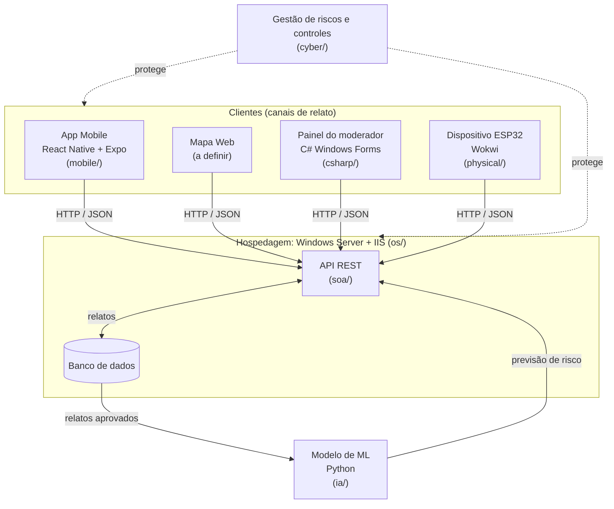

# Especificação do Moskitto Radar

Parte técnica que antes ficava no [README da raiz](../README.md): a ideia, os requisitos, o modelo de dados,
a arquitetura e os combinados da equipe. Ainda são **specs iniciais**, a refinar pelo time.
O formato exato dos dados e as rotas da API estão no [`AGENTS.md`](../AGENTS.md), seção 4.

## A ideia

Criar um **mapa de relatos de roubo totalmente interativo e dinâmico**.

Pessoas registram onde e quando foram vítimas ou testemunhas de um roubo ou furto. Esses relatos viram pontos num mapa que se atualiza em tempo real e pode ser explorado por filtros de tipo, período e região. O objetivo é que o cidadão decida por onde andar, a que horas e com que cuidado, com base em dados da própria comunidade.

### Alinhamento com a GS

| Pergunta do briefing | Resposta (genérica, a refinar) |
|---|---|
| Quem é o cidadão beneficiado? | Quem se desloca a pé ou de transporte público pela cidade: estudantes, trabalhadores, idosos e moradores de bairros com pouca informação de segurança |
| Qual problema será resolvido? | Falta de informação acessível e atualizada sobre onde e quando ocorrem roubos, o que impede escolhas mais seguras |
| Como a solução funcionará? | Relatos de várias origens → API → mapa interativo + previsão de risco |
| Quais tecnologias? | Ver [Arquitetura](#arquitetura-geral) |
| Quem participa do ecossistema? | Cidadãos, moderadores, comunidade local e, futuramente, órgãos de segurança pública |
| Como medir o impacto? | Ver [Indicadores de impacto](#indicadores-de-impacto) |

**ODS conectados:** ODS 11 (Cidades e comunidades sustentáveis) como principal. ODS 9 (inovação e infraestrutura) e ODS 10 (redução das desigualdades) como secundários. A justificativa por meta deve ser detalhada na [Ficha da CitizenTech](ficha-citizentech.md).

---

## Specs gerais

> Specs **genéricas e iniciais**. Servem de base comum para todas as disciplinas e devem ser refinadas pela equipe.

### Requisitos funcionais

| ID | Requisito |
|---|---|
| RF01 | O usuário registra um relato com tipo, localização, data/hora e descrição opcional |
| RF02 | Os relatos aparecem em um **mapa interativo** (zoom, arrastar, clicar em um ponto para ver o detalhe) |
| RF03 | O mapa tem **filtros** por tipo de ocorrência, período e região |
| RF04 | O mapa **atualiza dinamicamente**, sem recarregar a página, quando entram novos relatos |
| RF05 | O mapa pode mostrar pontos individuais ou uma **visão agregada** (mapa de calor ou clusters) |
| RF06 | O usuário se identifica e a identificação é lembrada ao reabrir o app |
| RF07 | Relatos novos passam por **moderação** (aprovar, rejeitar, marcar como duplicado) antes de aparecer no mapa |
| RF08 | O sistema mostra uma **previsão de risco** por região e horário, gerada pelo modelo de ML |
| RF09 | O relato pode ser enviado por **vários canais**: app mobile, web, desktop e dispositivo IoT |
| RF10 | O usuário recebe um **aviso** ao entrar ou se aproximar de uma zona de maior risco |

### Requisitos não funcionais

| ID | Requisito |
|---|---|
| RNF01 | **Privacidade:** nenhum dado pessoal real. Relatos são anônimos e sem identificação de pessoas, placas ou documentos |
| RNF02 | **Localização imprecisa:** coordenadas arredondadas ou deslocadas, sem expor endereço exato de residência |
| RNF03 | **Dados simulados ou públicos**, sempre com a origem citada |
| RNF04 | **Segurança desde a concepção:** entradas validadas, consultas parametrizadas e portas sensíveis fechadas |
| RNF05 | **Simplicidade e acessibilidade:** textos legíveis, bom contraste, linguagem simples, telas pequenas |
| RNF06 | **Tolerância a falhas:** o serviço e o site se recuperam sozinhos após uma falha |
| RNF07 | **Rastreabilidade:** logs de auditoria de acesso e de ações de moderação |
| RNF08 | **Repositório organizado:** cada parte tem README claro e nomes que façam sentido |

### Modelo de dados (genérico)

| Entidade | Campos principais |
|---|---|
| **Relato** | `id`, `tipo`, `descricao`, `latitude`, `longitude`, `ocorrido_em`, `criado_em`, `status`, `origem` |
| **Usuário** | `id`, `apelido` (ou identificador anônimo), `papel` (cidadão / moderador) |
| **Moderação** | `id`, `relato_id`, `moderador_id`, `decisao`, `motivo`, `decidido_em` |
| **Previsão de risco** | `região`, `faixa_horária`, `nível_de_risco`, `gerado_em` |

- **Tipo:** celular, bolsa/mochila, veículo, bicicleta, comércio, outro.
- **Status:** pendente, aprovado, rejeitado.
- **Origem:** mobile, web, desktop, iot.

### Arquitetura geral

| Camada | Disciplina | Responsabilidade |
|---|---|---|
| Backend / API / banco | `soa/` | Domínio, API REST, banco de dados, migrações, testes no Insomnia |
| App do cidadão | `mobile/` | Mapa, lista, detalhe, cadastro de relato, recurso nativo (localização/câmera) |
| Painel do moderador | `csharp/` | Windows Forms para moderar e administrar relatos |
| Inteligência | `ia/` | Modelo de previsão de risco, treinado e avaliado, e integrado à solução |
| Dispositivo | `physical/` | Circuito ESP32 no Wokwi, integrado à solução |
| Infraestrutura | `os/` | Windows Server (AD, DNS, IIS, GPO) hospedando a aplicação web |
| Segurança | `cyber/` | Gestão de riscos, controles técnicos e evidências |
| Arquitetura e narrativa | `testing/` | Diagrama ArchiMate/TOGAF, documento descritivo e pitch |

**Ainda em aberto:** onde fica o front-end web do mapa. Provável opção: servido pelo backend (`soa/`) e hospedado no IIS (`os/`). A equipe deve decidir.

### Fluxo principal

1. O cidadão registra um relato (mobile, web ou dispositivo).
2. A API valida e salva o relato como **pendente**.
3. O moderador (desktop C#) aprova ou rejeita.
4. O relato aprovado aparece no mapa de todos, em tempo real.
5. O modelo de ML usa os relatos aprovados para atualizar a previsão de risco por região e horário.
6. O mapa e o app exibem a previsão e avisam quando o usuário se aproxima de uma zona de risco.

### Indicadores de impacto

Sugestões iniciais, a refinar:
- Número de relatos registrados e aprovados
- Tempo entre o relato e sua aparição no mapa
- Cobertura: regiões e bairros com relatos
- Precisão do modelo de previsão (métrica definida pela disciplina de IA)
- Usuários que consultaram o mapa antes de um deslocamento

### Fora de escopo (por enquanto)

- Integração oficial com a polícia ou emissão de boletim de ocorrência
- Identificação ou acusação de pessoas
- Dados pessoais reais
- Cobertura de várias cidades

> O mapa **não substitui** o registro oficial de ocorrência.

---

## Combinados da equipe

Vindos do briefing da GS (detalhes em [`desafio-3es.md`](desafio-3es.md)):

- **Simples primeiro:** melhor uma função que funciona do que dez pela metade.
- **Pense em quem vai usar:** cidadão real, não especialista.
- **IA como copiloto:** registrar os prompts em `prompts.md` e saber explicar cada linha.
- **Todo mundo constrói:** cada integrante sabe explicar o projeto inteiro.
