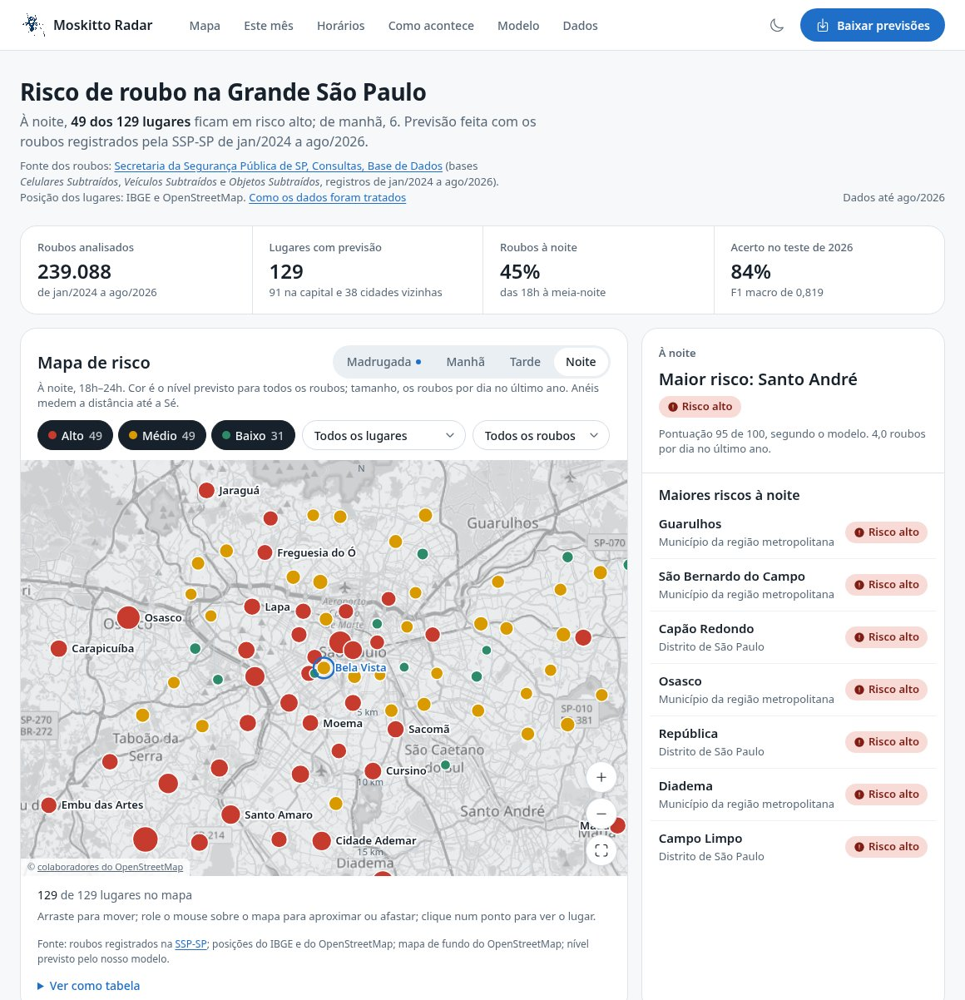
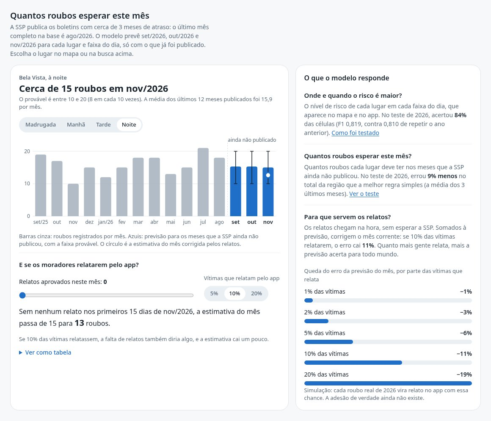
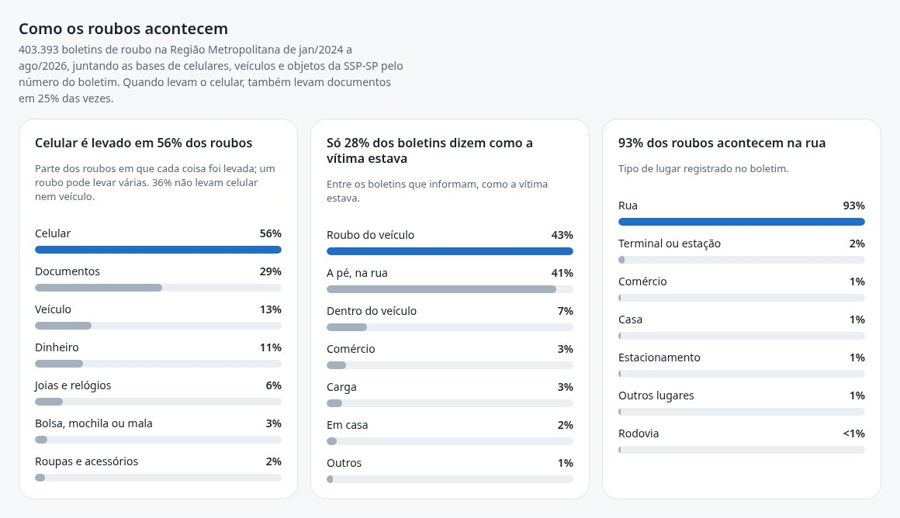
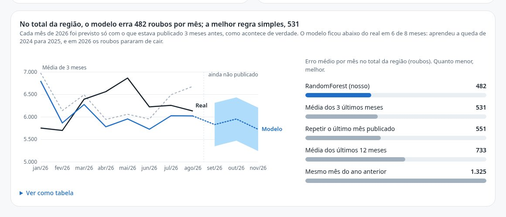

# Moskitto Radar · Previsão de risco de roubo (IA & ML)

## Ficha da CitizenTech

| Campo | Resposta |
|---|---|
| **Nome da CitizenTech** | Moskitto Radar (mapa de relatos de roubo) |
| **Cidade e bairro** | Região Metropolitana de São Paulo: 3 bairros da Av. Paulista, 88 distritos da capital e 38 municípios vizinhos |
| **Cidadão beneficiado** | Quem mora ou circula pela região metropolitana e quer saber onde e quando o risco de roubo é maior |
| **Problema, em uma frase** | Não há um lugar simples onde o morador veja, no celular, onde e quando os roubos acontecem. |
| **Link do repositório** | <https://github.com/GrupoMoskitto/gs2026> |
| **ODS conectados** | 11 (principal), 9 e 10 |

| Nome | RM |
|---|---|
| Gabriel Couto (responsável por esta parte) | RM559579 |
| Gabriel Kato | RM560000 |
| João Vitor de Matos | RM559246 |
| Marcelo Affonso | RM559790 |

## Proposta

Usar os roubos registrados pela SSP-SP para responder duas perguntas do morador:

1. **Onde e quando o risco é maior?** Um modelo classifica cada lugar, em cada faixa do dia, como risco baixo,
   médio ou alto. Esse nível vai para a API e aparece no mapa do app.
2. **Quantos roubos esperar este mês?** A SSP publica com uns 3 meses de atraso. Um segundo modelo prevê os meses
   que faltam, e os relatos dos moradores no app corrigem essa previsão na hora. É aqui que cada relato ajuda
   todo mundo.

## Resultado

| Pergunta | Modelo | Melhor regra simples |
|---|---|---|
| Nível de risco (teste em 2026) | F1 macro **0,819** · acurácia 0,842 | 0,810 (repetir o nível do ano anterior) |
| Roubos no mês (teste em 2026, 3 meses de atraso) | erro de **482** roubos/mês na região | 531 (média dos 3 últimos meses) |
| Relatos do app (simulação) | erro cai **11%** com 10% das vítimas relatando, **19%** com 20% | — |

O modelo nunca confunde risco baixo com alto. Na previsão do mês, a vantagem sobre a regra simples é pequena, e em
2026 ele ficou abaixo do real em 6 de 8 meses: aprendeu a queda de 2024 para 2025, e os roubos pararam de cair.

## Vídeo

Apresentação da parte de IA (1 min 10 s), gravada no site de resultados com os dados agregados da SSP-SP. Os relatos
que aparecem corrigindo a previsão são simulados.

https://github.com/user-attachments/assets/0d705ad9-2f60-4e99-a0ab-fc1a38b6b190

## Site









## Dados

| Dado | Origem | No Git? |
|---|---|---|
| Roubos de 2024 a ago/2026 | SSP-SP, [Consultas → Base de Dados](https://www.ssp.sp.gov.br/estatistica/consultas): *Celulares*, *Veículos* e *Objetos Subtraídos* (dados abertos) | **Não.** As planilhas têm endereço, CEP e placa; ficam em `docs/`, fora do Git |
| Contagens por lugar, dia e faixa | `scripts/extrair_ssp.py` | Sim, só contagens (`data/`) |
| Perfil dos roubos (o que levam, onde) | `scripts/extrair_perfil.py` | Sim, só contagens (`data/perfil_roubos.json`) |
| 129 lugares | IBGE e OpenStreetMap (ODbL), os mesmos do app | Sim (`data/lugares.csv`) |
| Relatos para a API | **Simulados** na proporção dos roubos reais (`scripts/gerar_relatos.py`, seed 42) | Sim (`data/relatos_simulados.csv`) |

Os dados são reais e públicos, mas a SSP avisa que são brutos e não são estatística oficial. Só roubo (art. 157),
só a Região Metropolitana, um boletim conta uma vez. São **239.088 roubos** de celular e veículo, que alimentam o
modelo, e 403.393 boletins contando a base de objetos.

## Como funciona

- **Preparação:** cada célula é um lugar × faixa do dia (× dia útil ou fim de semana, no nível). Na capital, o
  roubo vai para o distrito mais próximo; fora dela, para o município.
- **Nível:** RandomForest de classificação. Aprende com 2024 para prever 2025 e é testado em 2026. "Alto" são os
  20% de lugar e horário com mais roubos por dia (percentil 80); "baixo", até o percentil 50.
- **Mês:** RandomForest de regressão com o que já estava publicado (último mês, médias de 3 e de 12 meses,
  tendência). Cada mês de 2026 foi previsto só com o que se sabia na época.
- **Relatos:** média gama-Poisson entre a previsão e os relatos do mês, divididos pela parte das vítimas que relata.
- **Métricas:** F1 macro no nível ("alto" é a classe menor) e erro absoluto médio no mês, sempre contra regras
  simples.

Detalhes, figuras e escolhas estão no notebook [`notebooks/modelo_risco.ipynb`](notebooks/modelo_risco.ipynb).

## Integração

| Arquivo | Quem usa |
|---|---|
| `data/previsoes.json` | API do João (`GET /api/previsoes`) → mapa e aba Risco do app |
| `data/relatos_simulados.csv` | API do João (carga inicial) |
| `data/previsao_mensal.json` · `data/perfil_roubos.json` | Site de resultados (`web/`) |

## Como rodar

```bash
cd ia
uv venv .venv && uv pip install --python .venv/bin/python -r requirements.txt

.venv/bin/python scripts/montar_notebook.py   # treina, testa e gera previsões e figuras (~40 s)
.venv/bin/pytest -q                           # 82 testes
docker compose up --build                     # site em http://localhost:5000
```

Refazer a extração (opcional) exige as planilhas da SSP em `docs/`: `scripts/extrair_ssp.py` (~3 min) e
`scripts/extrair_perfil.py` (~20 min).

## Evidências

- Notebook executado: [`notebooks/modelo_risco.ipynb`](notebooks/modelo_risco.ipynb)
- Métricas: [`data/metricas.json`](data/metricas.json) e [`data/previsao_mensal.json`](data/previsao_mensal.json)
- Figuras: [`figuras/`](figuras/) · prints do site: [`figuras/site/`](figuras/site/)
- Contagem de cada etapa da limpeza: [`data/extracao_resumo.json`](data/extracao_resumo.json)
- Uso de IA: [`prompts.md`](prompts.md)

## Limitações

- Base bruta: cerca de 7% dos roubos da capital vêm sem coordenada; dez/2024 (veículos) e mar/2024 (objetos) estão
  incompletos.
- O nível é relativo à região, não um risco absoluto; municípios inteiros aparecem ao lado de distritos.
- O efeito dos relatos é simulado. Relatos reais podem ter viés e relatos falsos; só os aprovados entram na conta.
- 32 meses de dados não bastam para aprender sazonalidade nem para prever anos à frente.
- Roubos que ninguém registrou não aparecem em nenhuma base.
