# Moskitto Radar · App do cidadão (mobile)

## Ficha da CitizenTech

| Campo | Resposta |
|---|---|
| **Nome da CitizenTech** | Moskitto Radar (mapa de relatos de roubo) |
| **Cidade e bairro** | Região Metropolitana de São Paulo: distritos da capital e municípios vizinhos (o projeto começou pela Av. Paulista) |
| **Cidadão beneficiado** | Quem mora ou circula pela região metropolitana e quer saber onde e quando o risco é maior. *A pessoa real ouvida: o time ainda precisa preencher.* |
| **Problema, em uma frase** | Não há um lugar simples onde o morador veja, no celular, onde e quando os roubos acontecem. |
| **Como funciona** | A pessoa relata um roubo no app (local, horário e tipo, sem dados pessoais). A API guarda os relatos, um modelo de aprendizado de máquina prevê o risco por lugar e faixa horária, e o app mostra isso no mapa e na lista. |
| **O que cada parte faz** | **Mobile:** este app. **API (SOA):** guarda e serve os relatos. **ML:** prevê o risco. **C#:** app de moderação. **ESP32:** botão de pânico que também gera relatos. **OS:** Windows Server com IIS. **Segurança e testes:** relatório de riscos, diagrama e pitch. |
| **Link do repositório** | <https://github.com/GrupoMoskitto/gs2026> |
| **Indicador de impacto** | *A definir pelo time (documento de Testing).* |
| **ODS conectados** | 11 (principal), 9 e 10 |

| Nome | RM |
|---|---|
| Gabriel Kato | RM560000 |
| Gabriel Couto | RM559579 |
| João Vitor de Matos | RM559246 |
| Marcelo Affonso | RM559790 |

Os dados são **simulados**. Nenhum dado pessoal real é usado.

---

## O que é

App em **React Native + Expo (Expo Go) + TypeScript estrito**, com interface nativa: abas e cabeçalhos do
sistema, **Liquid Glass** no iOS 26 e **Material 3** no Android, com plano B para versões antigas.

**Telas**

| Tela | Arquivo | O que faz |
|---|---|---|
| Identificação | `src/app/identificacao.tsx` | Apelido + RM, lembrados ao reabrir o app |
| Mapa *(proposta)* | `src/app/(tabs)/mapa/` | Relatos aprovados como pontos e cada bairro pintado pelo risco de agora. Busca de lugar, filtro por tipo e bairro, legenda de risco |
| Relatos | `src/app/(tabs)/relatos/` | Lista com filtro por bairro, carregando, erro, vazio, sem conexão e puxar para atualizar |
| Risco | `src/app/(tabs)/risco/` | Previsão por bairro e faixa horária (`GET /api/previsoes`) |
| Ajustes | `src/app/(tabs)/ajustes.tsx` | Tema (automático, claro, escuro), conta e sair, relatos aguardando envio, privacidade e sobre o app |
| Detalhe | `src/app/relato/[id].tsx` | Um relato, mini mapa e risco da região |
| Novo relato | `src/app/novo.tsx` | Formulário validado; localização do celular com **permissão negada tratada** |

## Vídeo

Apresentação do app (1 min 09 s), gravada no emulador Android com dados simulados.

https://github.com/user-attachments/assets/c512c137-4e47-4dd3-8c8a-e3014b73f04b

## Prints

Emulador Android (Pixel 8) no Expo Go, sem a API ligada: o app usa os **dados de exemplo** e avisa isso na faixa azul.
A identidade na tela (Marina, RM123456) é fictícia. Todas as imagens estão em [`prints/`](prints/), inclusive
[`17-ajustes-escuro.png`](prints/17-ajustes-escuro.png).

| | | | |
|---|---|---|---|
|  | 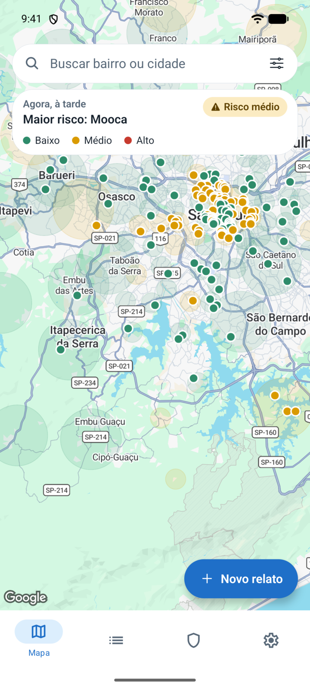 | 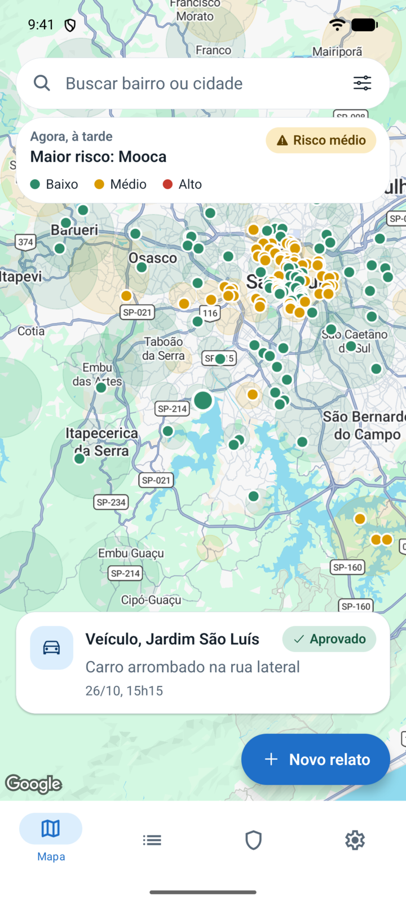 | 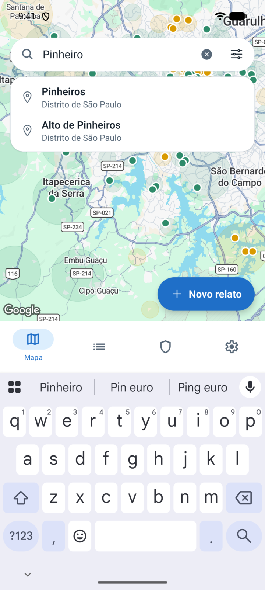 |
| *Identificação* | *Mapa* | *Relato no mapa* | *Busca de lugar* |
| 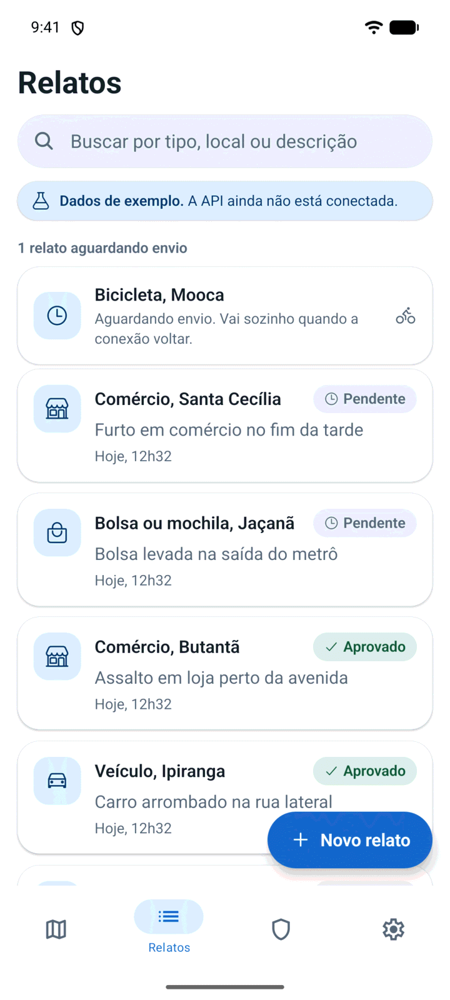 | 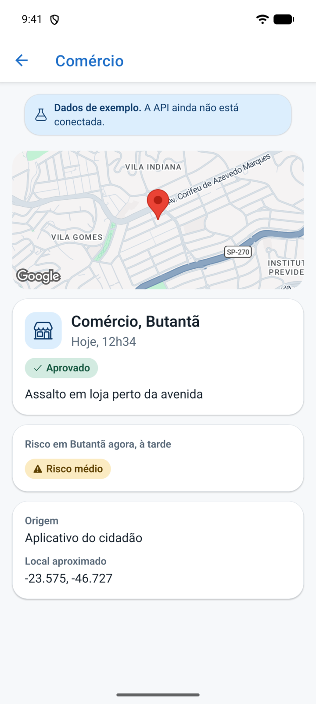 | 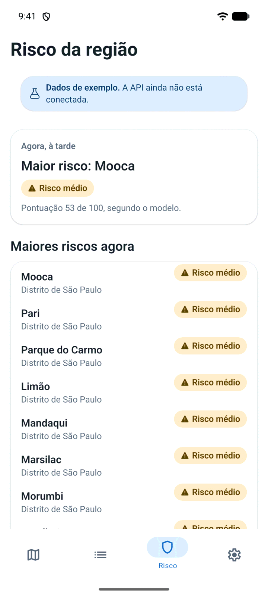 | 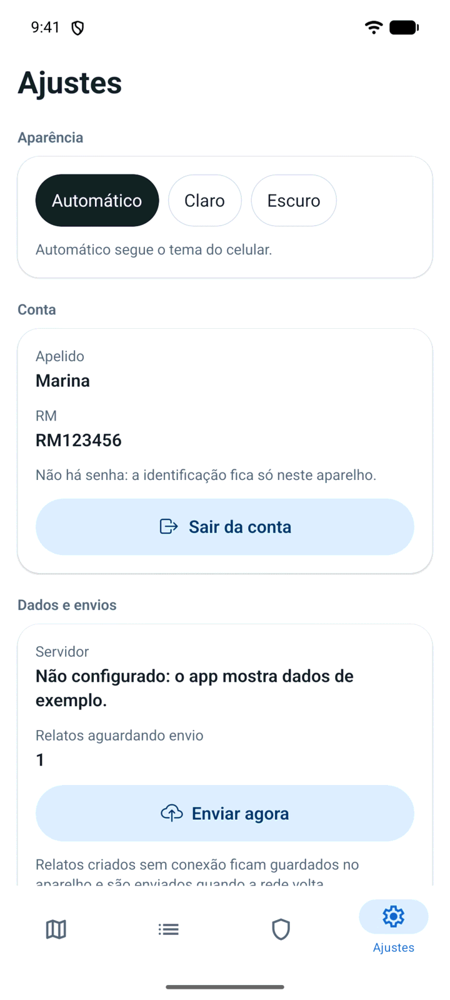 |
| *Relatos* | *Detalhe* | *Risco* | *Ajustes* |
| 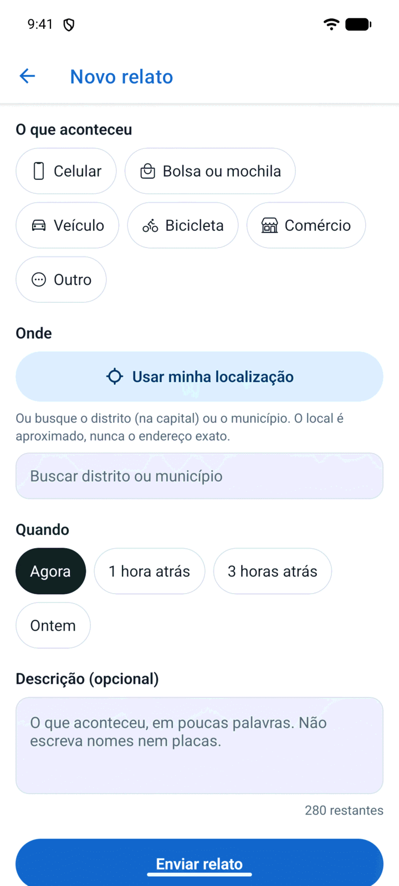 | 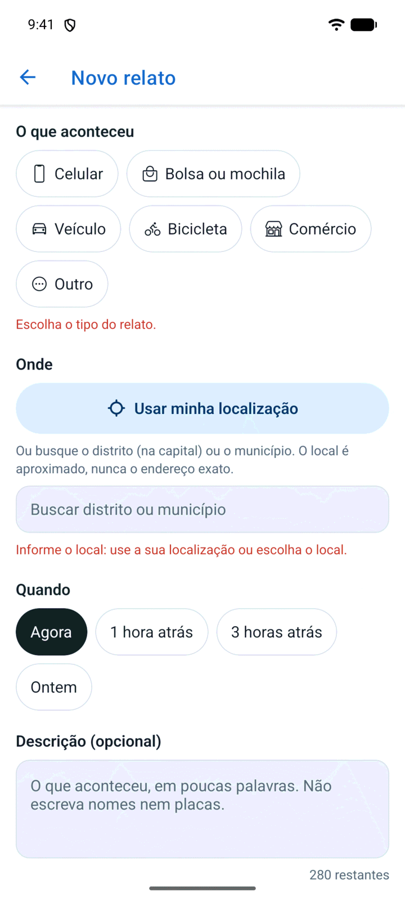 | 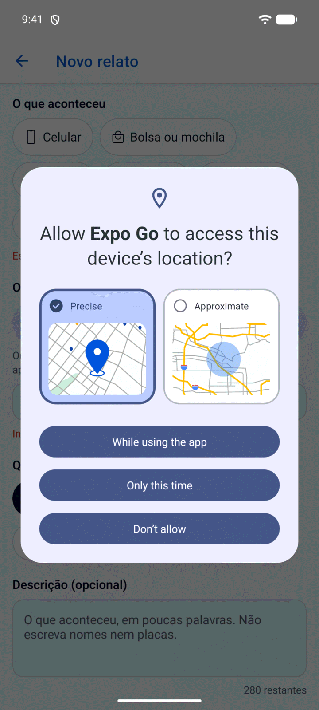 | 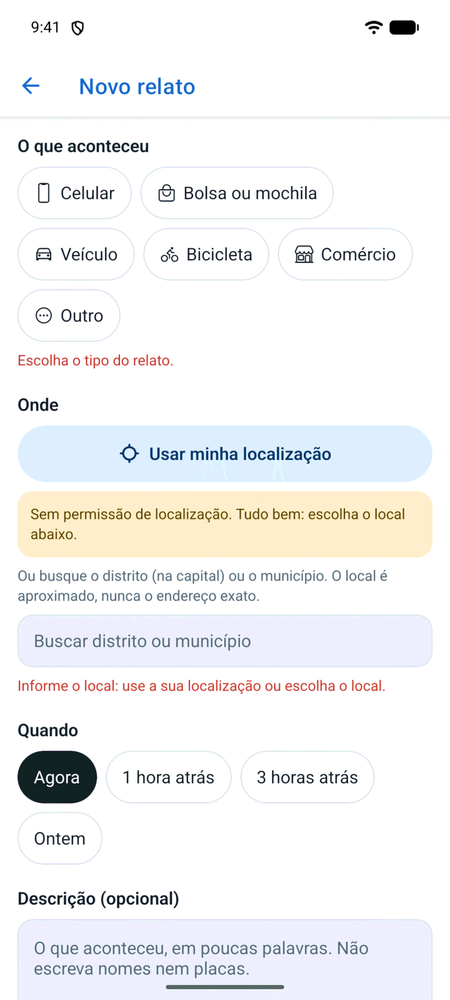 |
| *Novo relato* | *Validação* | *Pedido de permissão* | *Permissão negada* |
| 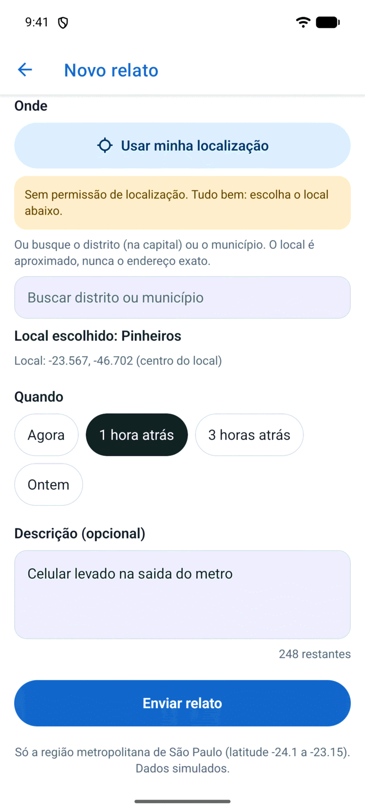 |  | 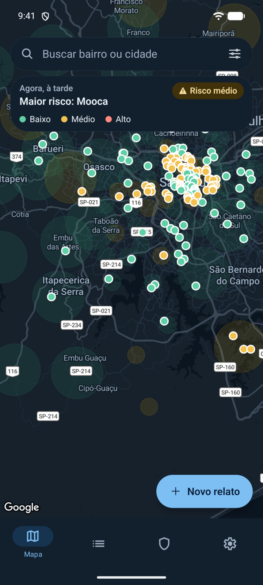 | 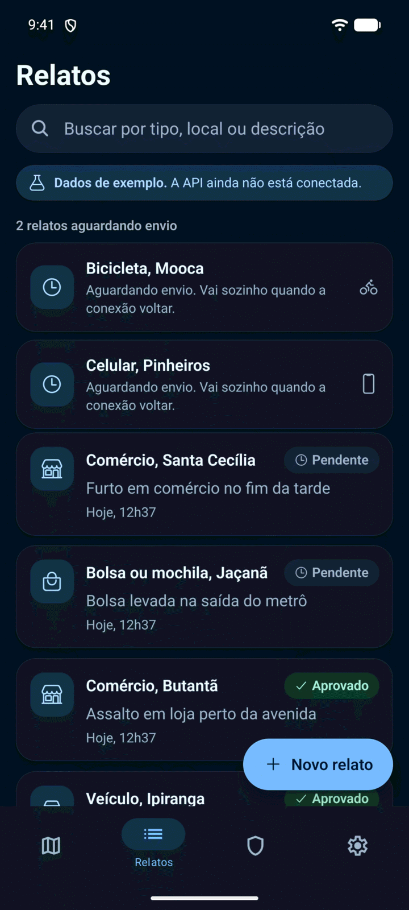 |
| *Formulário preenchido* | *Relato salvo* | *Mapa (escuro)* | *Relatos (escuro)* |

O fluxo do recurso nativo aparece em sequência: o pedido de permissão do sistema (10), a recusa tratada com um aviso e a busca
manual (11) e o relato salvo na fila do aparelho porque não há conexão com a API (13).

## Como rodar

Precisa de Node 20 ou mais novo e do app **Expo Go** no celular (ou um emulador).

```bash
cd mobile
npm install
cp .env.example .env     # opcional: aponta para a API do João
npx expo start           # leia o QR Code com o Expo Go
```

- **Sem `.env`**, o app roda com **dados de exemplo** e avisa isso na tela (faixa azul no topo).
- **Com a API**, ponha o IP do computador na mesma rede Wi-Fi em `EXPO_PUBLIC_API_URL`
  (no celular, `localhost` é o próprio celular).
- Se a API cair, o app mostra a **última resposta salva** e, sem ela, os dados de exemplo.

**Verificações**

```bash
npm run typecheck   # tsc --noEmit (tem que sair limpo)
npm run lint        # expo lint
npm test            # 29 testes da camada pura (validação, tempo, geografia, retry)
npx expo-doctor     # 20 de 20 verificações
```

## Estrutura

```
mobile/
├── src/
│   ├── app/          rotas (Expo Router): cada arquivo é uma tela
│   ├── components/   interface: Botao, Chip, Superficie (vidro), Selos, Estados, CartaoRelato
│   ├── hooks/        useRecurso (carregando/erro/pronto), useConexao, SessaoContexto
│   ├── data/         locais.json (lugares da busca, gerado por scripts/gerar-locais.mjs)
│   ├── services/     chamadas à API: http (retry), relatos, previsoes, fila, cache, exemplos
│   ├── theme/        cores (claro e escuro), espaço, raios, tipografia
│   ├── types/        formato dos dados (AGENTS.md, seção 4)
│   ├── utils/        validação, tempo, geografia, rótulos (sem React, testáveis)
│   └── config/       API e caixa de coordenadas da região
├── assets/           ícone do app e logo (assets/brand)
├── mockup/           mockups HTML do design (tokens.css é a fonte visual)
├── prints/           prints das telas (evidências)
└── proposta/         PDF da proposta de design
```

## Região

O app cobre a **Região Metropolitana de São Paulo**: os distritos da capital e os municípios das outras cidades.
O campo `bairro` do relato guarda o código do lugar. Os 3 bairros da Av. Paulista (ponto de partida do projeto) continuam válidos.
Mais detalhes e o que o time precisa combinar em [`DECISOES.md`](DECISOES.md).

## Busca de lugares no mapa

A busca é **local**: nada do que a pessoa digita sai do aparelho. A lista está em `src/data/locais.json`
(39 municípios da Região Metropolitana e 90 dos 96 distritos da capital), mais os 3 bairros do projeto e as 3 estações de metrô.

- **Nomes e códigos:** API de Localidades do IBGE (dados públicos).
- **Centro dos municípios:** calculado a partir da malha do IBGE.
- **Ponto dos distritos:** o IBGE não publica a geometria, então vem do Nominatim (OpenStreetMap), consultado **uma vez** pelo script.
  Atribuição: © colaboradores do OpenStreetMap (ODbL), também mostrada em Ajustes.
- **Fora da lista:** Anhanguera, José Bonifácio, Pedreira, Santana, Socorro e Tremembé. O Nominatim devolveu pontos que não
  eram do distrito e preferimos não incluir pontos duvidosos.
- **Gerar de novo:** `node scripts/gerar-locais.mjs` (precisa de internet e leva cerca de 2 minutos).

A lista só move o mapa. O contrato de dados (`bairro` com 3 valores) não mudou.

## Pensado para rede ruim

Em `src/services/` (regras em [`REGRAS.md`](REGRAS.md), seção 5):

- Tempo limite de 8 s em toda chamada e cancelamento ao sair da tela.
- **Nova tentativa com espera crescente e variação aleatória**, só em chamadas seguras de repetir.
  `POST` só repete com `Idempotency-Key`.
- Cache da última resposta e **dados de exemplo** como último recurso.
- Relato criado **sem conexão vai para uma fila** no aparelho e é enviado quando a rede volta.

## Evidências

- [x] Testado no Expo Go: iPhone (iOS 26) e emulador Android (Pixel 8)
- [x] [Prints das telas](#prints) no emulador Android, em [`prints/`](prints/)
- [x] [Vídeo demo](#vídeo) de até 2 minutos
- [x] `npx tsc --noEmit` limpo, sem `any`
- [x] `npm run lint` sem erros
- [x] `npx expo-doctor`: 20 de 20 verificações
- [x] `npm test`: 29 testes passando

## Entregas (19/11, 23h55)

- [x] App em React Native + Expo, **TypeScript estrito**
- [ ] ZIP da pasta do app **sem `node_modules`**, com os RMs no nome
- [x] `README.md` com a Ficha da CitizenTech
- [x] [`DECISOES.md`](DECISOES.md) *(falta o autor completar as referências de design)*
- [x] Array `authors` no `package.json` (nome e RM de todos)
- [x] [Vídeo demo](#vídeo) de até 2 minutos

## Avaliação

| Critério | Peso |
|---|---|
| Funcionalidade: 3+ telas com navegação, lista com carregando/erro/vazio, formulário validado que cria item, identificação lembrada ao reabrir | 40% |
| Qualidade TypeScript: modo estrito, sem `any`, `tsc --noEmit` limpo | 30% |
| Recurso nativo com permissão tratada | 20% |
| Organização e documentação: camada `services/`, validação pura, README e DECISOES | 10% |

**Portas de entrada:** `tsc` sem erro e sem `any`, app nativo (WebView não é aceito), identificação completa.

## Regras e design

- **[`REGRAS.md`](REGRAS.md):** regras do app (interface nativa, mobile-first, skills de design, referências, API para rede ruim, logo). Leia antes de mexer aqui.
- **Mockups** (abrir no navegador, sem servidor): [`mockup/index.html`](mockup/index.html) (telas), [`mockup/fundamentos.html`](mockup/fundamentos.html) (logo, paleta, tipografia), [`mockup/componentes.html`](mockup/componentes.html) (componentes iOS e Android) e [`mockup/tokens.css`](mockup/tokens.css) (tokens, copiados para `src/theme/`).
- **Logo:** [`assets/brand/`](assets/brand/).
- **Proposta de design (PDF):** [`proposta/PROPOSTA-DESIGN.pdf`](proposta/PROPOSTA-DESIGN.pdf), 17 slides.
- **Uso de IA:** [`prompts.md`](prompts.md).

## Status

App completo, verificado por `tsc`, lint, testes e `expo-doctor`, e testado no Expo Go em iPhone (iOS 26) e no
emulador Android. Vídeo demo gravado e prints das telas em [`prints/`](prints/). Falta para a entrega: o ZIP sem `node_modules`
(veja as pendências no [`DECISOES.md`](DECISOES.md)).

Detalhes da disciplina: [`docs/disciplinas.md`](../docs/disciplinas.md#5-mobile-development--iot)
