# os: Operating Systems

**Papel no projeto:** infraestrutura **Windows Server** que hospeda a API do Moskitto Radar, é monitorada e responde a falhas.

## Ficha da CitizenTech

| Campo | Resposta |
|---|---|
| **Nome da CitizenTech** | Moskitto Radar (mapa de relatos de roubo) |
| **Cidade e bairro** | Região Metropolitana de São Paulo: distritos da capital e municípios vizinhos (o projeto começou pela Av. Paulista) |
| **Problema, em uma frase** | Não há um lugar simples onde o morador veja, no celular, onde e quando os roubos acontecem. |
| **Como funciona** | A pessoa relata um roubo no app (local, horário e tipo, sem dados pessoais). A API guarda os relatos, um modelo de aprendizado de máquina prevê o risco por lugar e faixa horária, e o app mostra isso no mapa e na lista. |
| **Papel desta parte** | O servidor Windows (`MoskittoServer`, domínio `moskitto.br`) onde a API roda no IIS, com rede, Active Directory, DNS, firewall, monitoramento e logs. |
| **Link do repositório** | <https://github.com/GrupoMoskitto/gs2026> |
| **ODS conectados** | 11 (principal), 9 e 10 |

| Nome | RM |
|---|---|
| Gabriel Kato | RM560000 |
| Gabriel Couto | RM559579 |
| João Vitor de Matos | RM559246 |
| Marcelo Affonso | RM559790 |

## Vídeo

Apresentação do servidor (1 min 20 s): a máquina virtual, a rede, a API no IIS, o firewall, o Nmap visto de fora e o
alerta de CPU disparando no teste de estresse. As telas são os prints de [`images/`](images/).

<!-- Cole aqui o link do vídeo: arraste o .mp4 para este README no editor do GitHub. -->

## Servidor

Windows Server 2025 Datacenter numa VM do VMware Workstation Pro, com 4 vCPUs, 4 GB de RAM, 128 GB NVMe e duas placas
de rede (NAT e a rede privada VMNet0). Serviços: IIS com a API, Active Directory, DNS, DHCP e Monitor de Desempenho.
Detalhes do hardware virtual e do host em [`server.md`](server.md).

| Item | Valor |
|---|---|
| Hostname | `MoskittoServer` |
| Domínio | `moskitto.br` |
| IP fixo | `10.0.1.1` (máscara `255.0.0.0`, gateway `10.0.0.1`) |

## Evidências

Prints feitos no servidor em 17/11/2026. Todos estão em [`images/`](images/).

### Rede e identidade

`ipconfig` com o IP fixo e `hostname`:

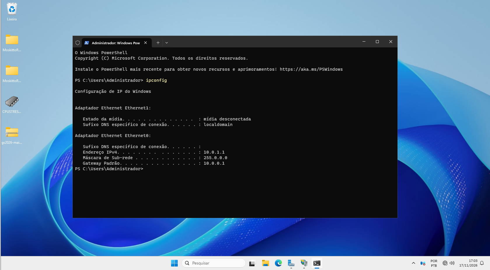
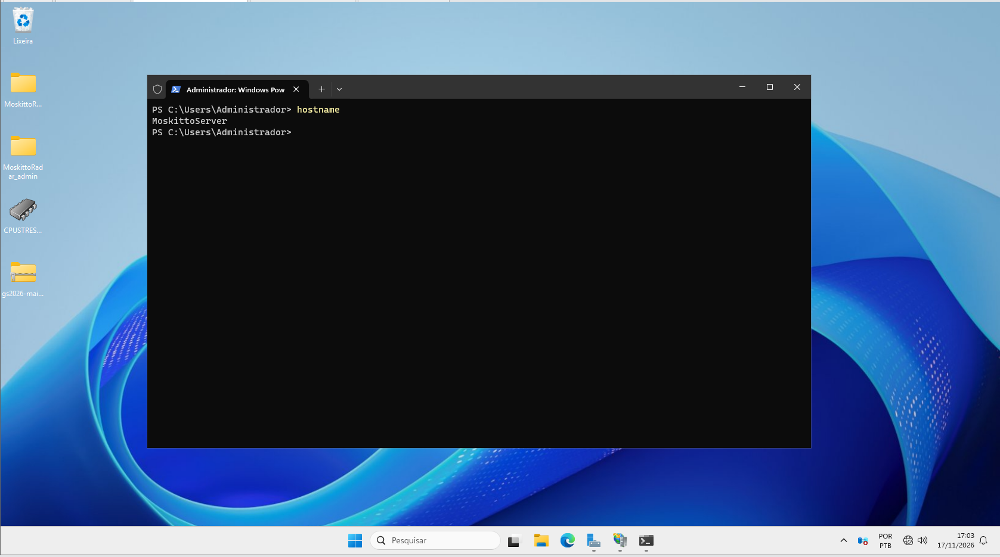

`nslookup` e `Test-NetConnection` resolvendo e alcançando `moskitto.br`:

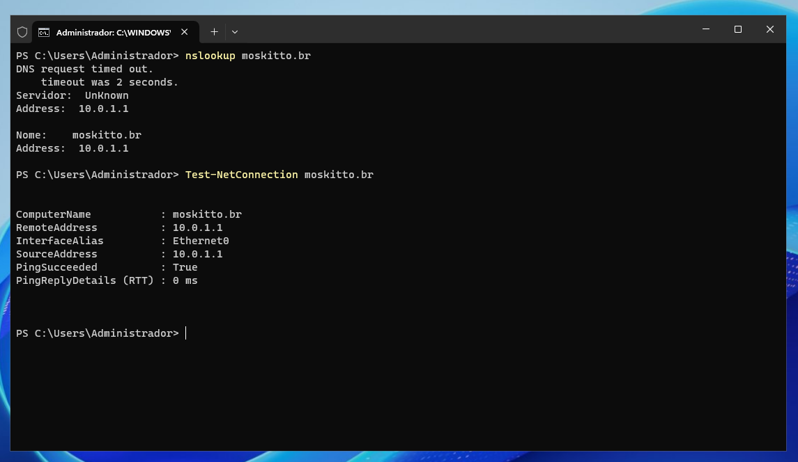

### API no IIS

Aplicação `MoskittoRadarAPI` no IIS, com a pasta `App_Data`, e o `/api/health` respondendo com status e banco `ok`:

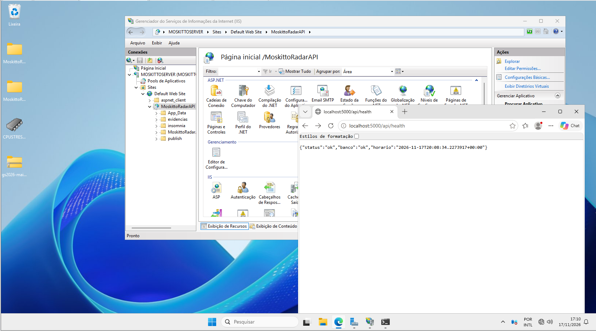

### Firewall e portas

Regras de entrada para as portas da API (5207 e 5000) e o firewall ligado nos três perfis:

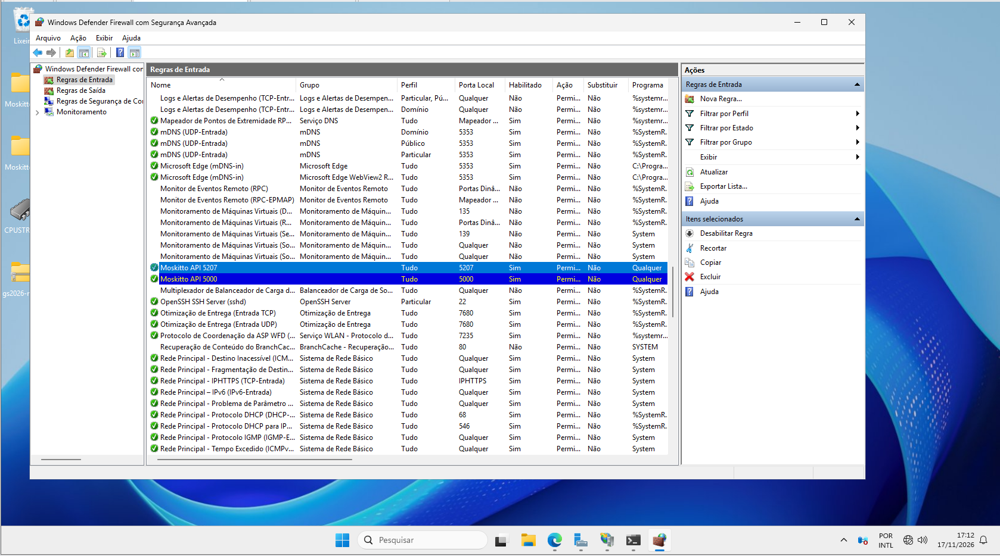
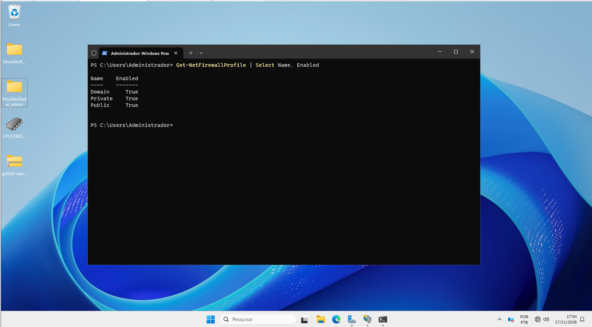

Portas abertas no servidor (`netstat`) e o scan do Nmap feito de outra máquina, que encontra DNS, IIS, Kerberos e o LDAP do AD:

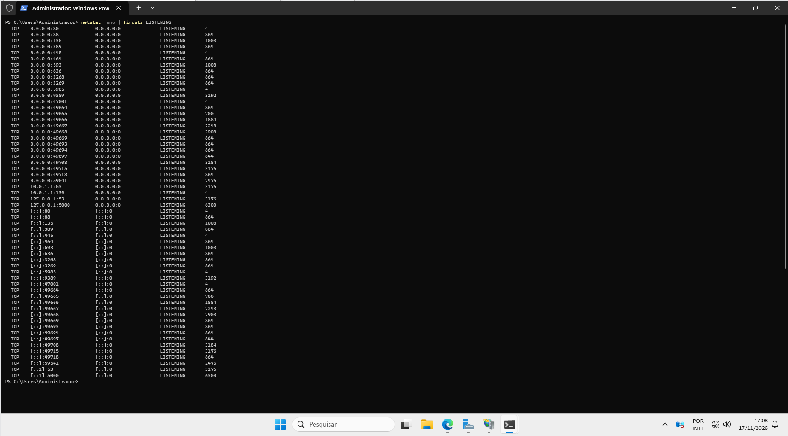
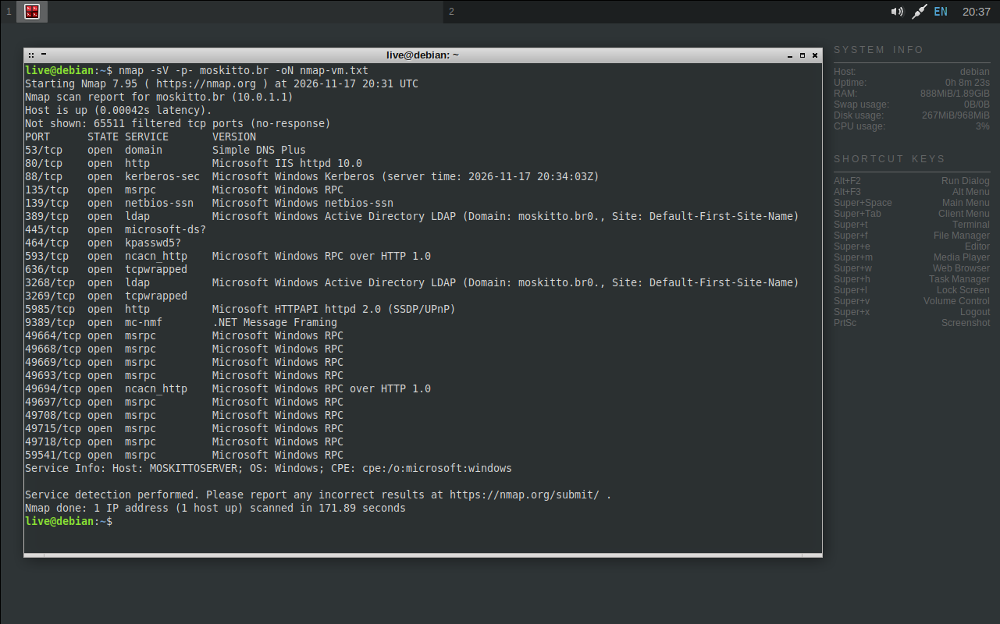

### Monitoramento

Alertas de CPU, RAM e disco no Monitor de Desempenho. No teste com o CPU Stress, a CPU passa de 80% e o alerta dispara:

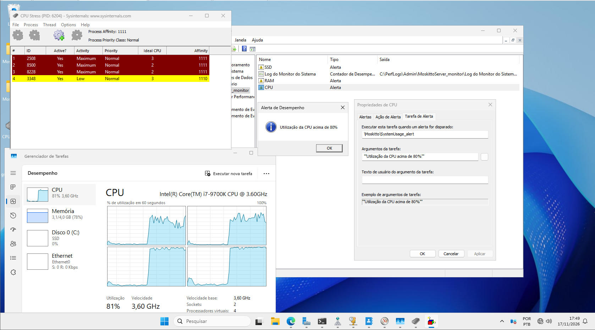

O alerta chama a tarefa agendada `SystemUsage_alert`, que roda o `alerta.vbs` e mostra o aviso na tela:

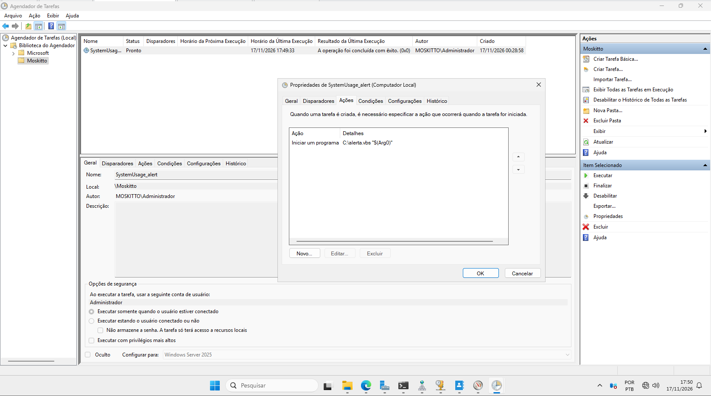
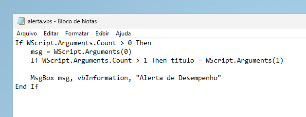

### Logs

Visualizador de Eventos do servidor, com os logs do sistema, do Directory Service e do DNS Server:

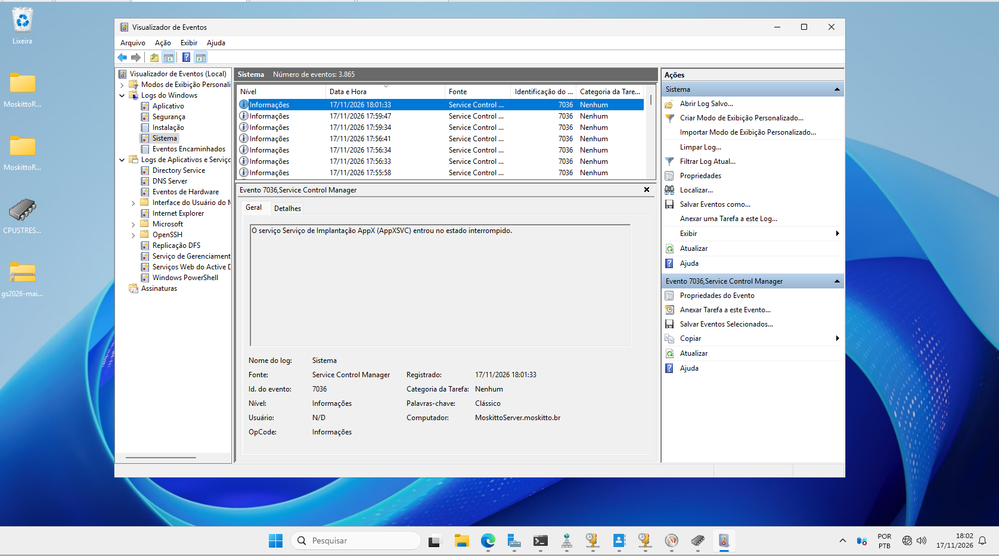

## Entregas (19/11, 23h55)

- [x] Repositório com `README.md` (com a Ficha da CitizenTech) e evidências (`ipconfig`, `nslookup`, `Test-NetConnection`)
- [x] Infraestrutura funcional: rede, domínio, IIS com a API e firewall
- [x] Alertas de CPU, disco e memória no Monitor de Desempenho (o print mostra o disparo do alerta de CPU)
- [ ] Teste de falha (recuperação automática do serviço e do pool)
- [ ] Roteiro de configuração
- [ ] Vídeo de demonstração de até 7 minutos
- [ ] Um único integrante envia o link

## Avaliação (10 pts)

| Critério | Pontos |
|---|---|
| Rede e identidade (IP fixo, hostname, DNS, domínio no AD) | 2 |
| Aplicação hospedada no IIS (site, pool, dependências, pasta, NTFS) | 2 |
| Monitoramento (CPU, disco, memória) | 2 |
| Tolerância a falhas (recuperação automática do serviço e do pool) e teste de falha | 1 |
| Logs de auditoria (Visualizador de Eventos e logs do IIS) | 1 |
| Funcionamento completo da proposta | 2 |

## Estrutura

```
os/
├── README.md
├── server.md   (descrição e especificações do servidor (VM) e seus serviços)
└── images/     (prints das evidências)
(as outras entregas serão feitas diretamente ao professor)
```

## Status

Em andamento. Feito: rede, domínio, IIS com a API, firewall, monitoramento com alerta e logs do sistema. Falta: teste
de falha com recuperação automática, logs do IIS, print da permissão NTFS no `App_Data`, roteiro de configuração e o
vídeo de até 7 minutos.

Detalhes da disciplina: [`docs/disciplinas.md`](../docs/disciplinas.md#6-operating-systems)
