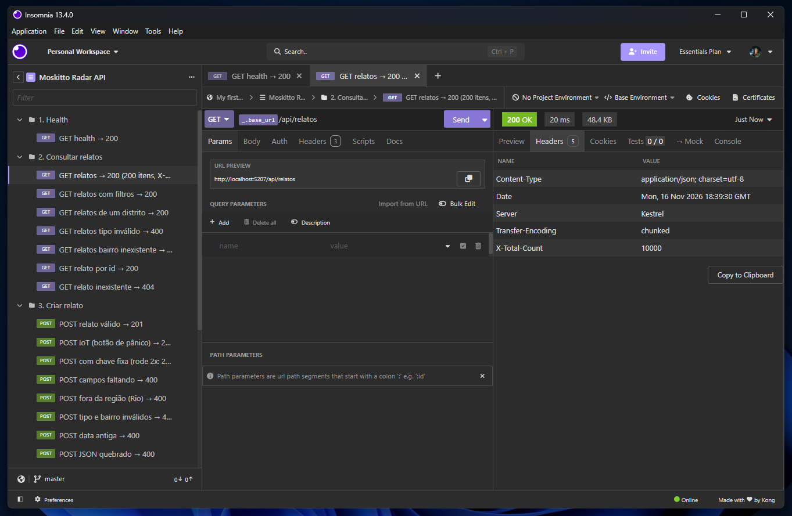
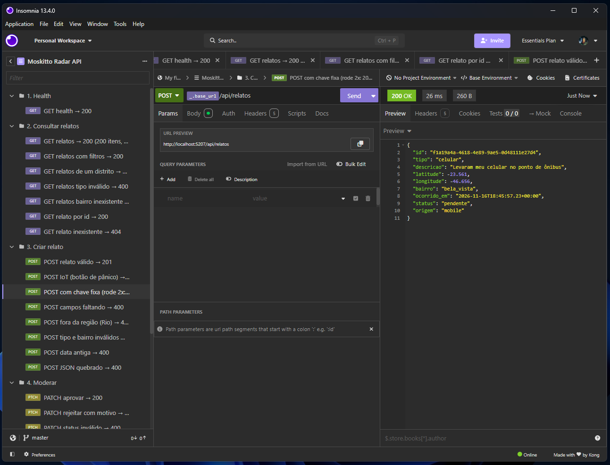
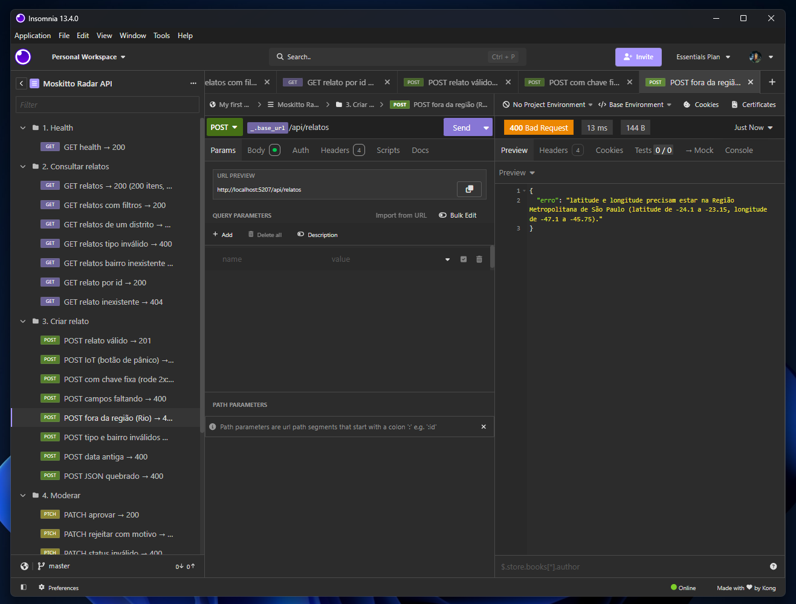
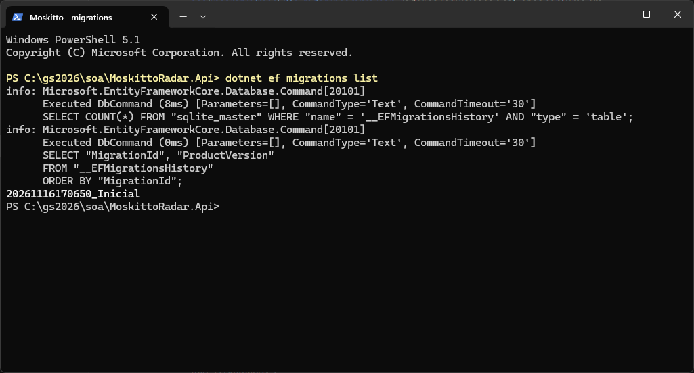

# Evidências · API (SOA)

Testes manuais no Insomnia 13 com a coleção `../insomnia/moskitto-radar.insomnia.json`, contra a API rodando local
(`http://localhost:5207`) com o banco recém-criado. Os relatos são simulados.

| # | Mostra |
|---|---|
| [01](01-health.png) | `GET /api/health` → 200 |
| [02](02-listar.png) | `GET /api/relatos` → 200, cabeçalho `X-Total-Count: 10000` |
| [03](03-filtros.png) | `GET /api/relatos` com bairro, tipo, status e limite |
| [04](04-detalhe.png) | `GET /api/relatos/{id}` → 200 e o 404 |
| [05](05-criar.png) | `POST /api/relatos` → 201, status `pendente` |
| [06](06-idempotencia.png) | mesmo POST com a mesma `Idempotency-Key` → 200 com o mesmo id |
| [07](07-validacao.png) | POST fora da região → 400 `{ "erro": "..." }` |
| [08](08-moderar.png) | `PATCH /api/relatos/{id}/status` → 200 |
| [09](09-previsoes.png) | `GET /api/previsoes?bairro=bela_vista` → 4 faixas |
| [10](10-migrations.png) | `dotnet ef migrations list`: migration `Inicial` aplicada |
| [11](11-banco.png) | tabelas do SQLite depois da carga: 129 lugares, 10.000 relatos, 516 previsões |

